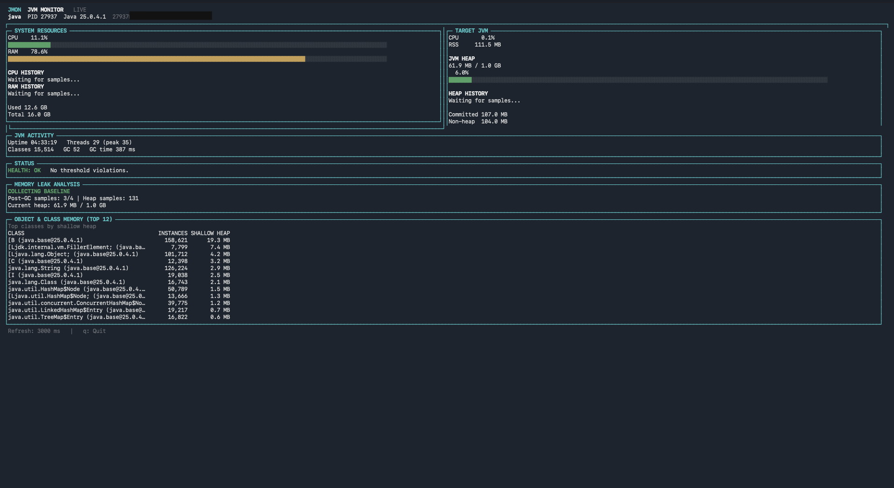

# JMon — Java Terminal Monitor

JMon is a terminal-based monitoring tool for Java developers. Inspired by `htop`, it provides real-time system resource monitoring, JVM metrics, and interactive process inspection from a single terminal interface.

JMon runs as a standalone CLI/TUI application. It does not need to be embedded into the Java applications it monitors.

## JMon Terminal UI



## Features

- **System Monitoring:** Real-time CPU and memory utilization.
- **Java Process Monitoring:** Identify and monitor Java processes, including CPU and resident memory usage.
- **JVM Metrics:** JVM uptime, heap and non-heap memory, thread counts, loaded classes, and garbage collection statistics.
- **Memory Analysis:** Class histogram analysis and memory investigation tools.
- **Interactive Terminal UI:** Live refresh, keyboard navigation, and an `htop`-inspired interface.
- **Version Information:** Display the installed version with `jmon --version`.

## Installation

### Requirements

- Java 17 or later.
- A supported terminal environment.
- Appropriate operating-system permissions to inspect or attach to the target JVM.

### macOS and Linux

JMon can be installed using the installation script.

```bash
curl -fsSL https://raw.githubusercontent.com/GokhanDurmaz/jmon/main/install.sh -o install.sh
bash install.sh
```

The installer downloads the latest published GitHub Release and installs JMon under your user directory.

Default locations:

- **Application:** `~/.local/opt/jmon`
- **Command:** `~/.local/bin/jmon`

If `~/.local/bin` is not already in your `PATH`, add it to your shell configuration.

For Zsh (the default shell on modern macOS):

```bash
echo 'export PATH="$HOME/.local/bin:$PATH"' >> ~/.zshrc
source ~/.zshrc
```

### Windows (CMD)

JMon can be installed using the Windows batch installer. Java 17 or later is required.

1. Download `install-windows.bat` from the repository.
2. Open **Command Prompt (CMD)**.
3. Navigate to the directory where you downloaded the file.
4. Run the installer:

```cmd
curl.exe -fL https://raw.githubusercontent.com/GokhanDurmaz/jmon/main/install-windows.bat -o "%USERPROFILE%\Downloads\install-windows.bat"
"%USERPROFILE%\Downloads\install-windows.bat"
```

The installer downloads the latest published GitHub Release, extracts JMon to your user directory, and adds the application's `bin` directory to your user `PATH`.

The default installation directory is:

```text
%USERPROFILE%\.local\opt\jmon
```

Close CMD and open a new window after installation so that the updated `PATH` takes effect.

Verify the installation:

```cmd
java -version
jmon --version
jmon --help
```

**Note:** Java 17 or later must be available in your terminal's `PATH`. If Java 8 is selected instead, update your `JAVA_HOME` and `PATH` to point to your Java 17+ installation.

The Windows installer requires a published GitHub Release containing `jmon-windows.zip`. A successful GitHub Actions build alone does not guarantee that a release has been published.

## Updating JMon

To update JMon, run the installation command again for your platform. The installer downloads the latest published release.

For macOS and Linux, run:

```bash
bash install.sh
```

For Windows, download the latest `install-windows.bat` from the repository and run it again from CMD.

## Uninstalling

### macOS and Linux

```bash
rm -f ~/.local/bin/jmon
rm -rf ~/.local/opt/jmon
```

### Windows (CMD)

```cmd
rmdir /S /Q "%USERPROFILE%\.local\opt\jmon"
```

You can also remove `%USERPROFILE%\.local\opt\jmon\bin` from your user `PATH` if you no longer use JMon.

Uninstalling does not remove your source-code checkout or project files.

## Usage

### Monitor a Java process

```bash
jmon --pid 12345
```

Replace `12345` with the PID of the Java process you want to monitor.

On Windows, use the same JMon arguments from CMD:

```cmd
jmon --pid 12345
```

To list Java processes, you can use:

```bash
jps -l
```

`jps` is included with the JDK.

### Monitor a Spring Boot application through Actuator

Spring Boot Actuator monitoring is optional. Pass an Actuator metrics
endpoint and, if required, the HTTP basic auth credentials:

```bash
jmon --pid 12345 --spring-endpoint http://localhost:8080
jmon --pid 12345 --spring-endpoint http://localhost:8080 --spring-user actuator --spring-password actuator
```

Notes:

- The application must expose `GET /actuator/metrics`; no other sensitive
  Actuator endpoint is required.
- JVM metrics matching metrics such as `jvm.memory.used` are collected only
  if they are exposed by the target application.
- Metric values are requested without tag filters, so Spring Boot aggregates
  them across every tag dimension. For example, `jvm.memory.used` combines
  the `heap` and non-heap memory areas. Tag-based breakdowns are a possible
  future feature.
- If authentication fails or the endpoint is unavailable, the Spring Boot
  panel shows the connection status while local JVM monitoring continues
  to work.

### Display version

```bash
jmon --version
```

The short form is also supported:

```bash
jmon -v
```

### Display help

```bash
jmon --help
```

### Run from the source code

Clone the repository and build the application using Gradle:

```bash
git clone https://github.com/GokhanDurmaz/jmon.git
cd jmon
./gradlew build
```

On Windows, use the Gradle wrapper batch file:

```cmd
gradlew.bat build
```

Run JMon through Gradle on macOS or Linux:

```bash
./gradlew run --args="--pid 12345"
```

On Windows:

```cmd
gradlew.bat run --args="--pid 12345"
```

Alternatively, create a local application distribution:

```bash
./gradlew installDist
./build/install/jmon/bin/jmon --pid 12345
```

On Windows:

```cmd
gradlew.bat installDist
build\install\jmon\bin\jmon.bat --pid 12345
```

## Requirements and Platform Support

- Java 17 or later.
- macOS and Linux are primary target platforms.
- Windows distribution and installation are provided; some monitoring capabilities may differ by operating system.
- Appropriate operating-system permissions may be required to inspect or attach to the target JVM.

## Technology Stack

| Technology | Purpose |
|---|---|
| Java 17+ | Application runtime |
| Gradle | Build and distribution |
| OSHI | Operating-system and hardware metrics |
| JLine | Terminal interaction and UI support |
| JNA | Native operating-system access |
| Tinylog / SLF4J | Logging |
| Apache HttpClient | HTTP integration; Spring Boot metrics integration is planned |

## Project Structure

| Package | Responsibility |
|---|---|
| `io.jmon.app` | Application entry point, CLI arguments, and configuration |
| `io.jmon.core` | Domain models, metric snapshots, and health evaluation |
| `io.jmon.system` | System, process, and JVM metric collection |
| `io.jmon.tui` | Terminal UI, input handling, and view models |

## Roadmap and Limitations

- **Spring Boot Metrics:** Integration with Spring Boot Actuator and Micrometer endpoints.
- **Disk Monitoring:** Disk capacity and I/O metrics.
- **Remote JMX:** Current JVM metrics focus on local processes through the Attach API.
- **Cross-platform Improvements:** Further testing and refinement of Windows-specific monitoring behavior.

## Development

Development guidelines and project-specific agent instructions are documented in [`CLAUDE.md`](CLAUDE.md) and [`SKILL.md`](SKILL.md).

## License

See the repository's `LICENSE` file for licensing information.